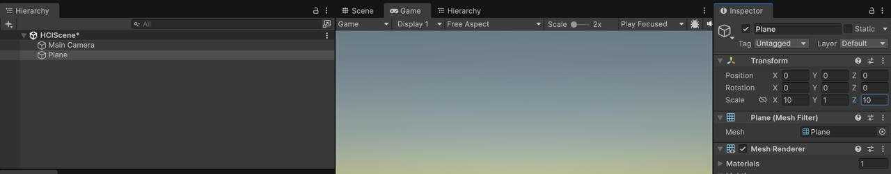
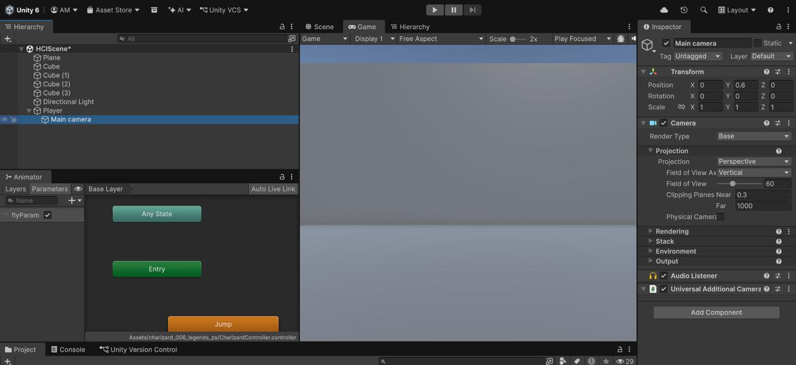
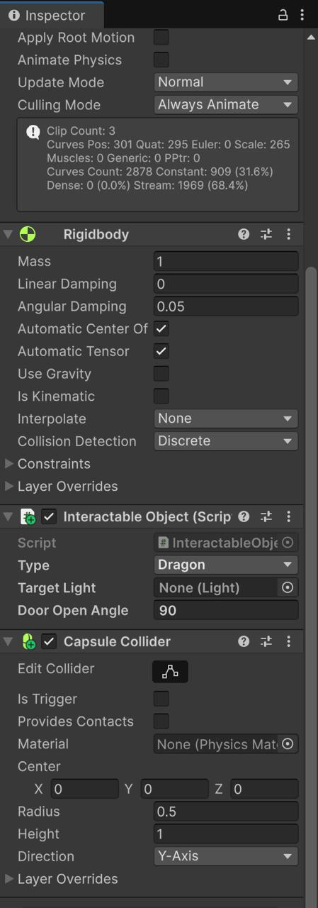
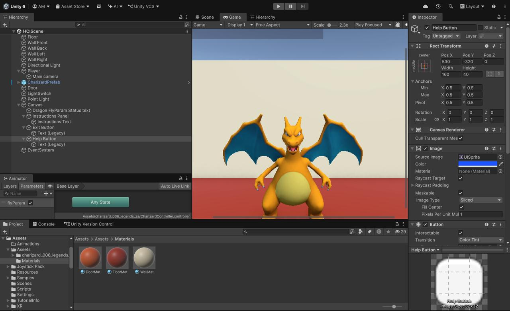
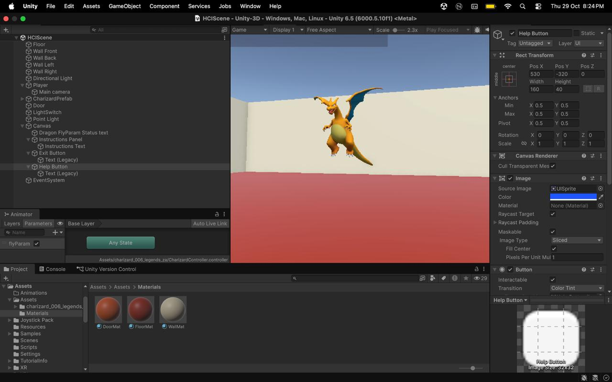
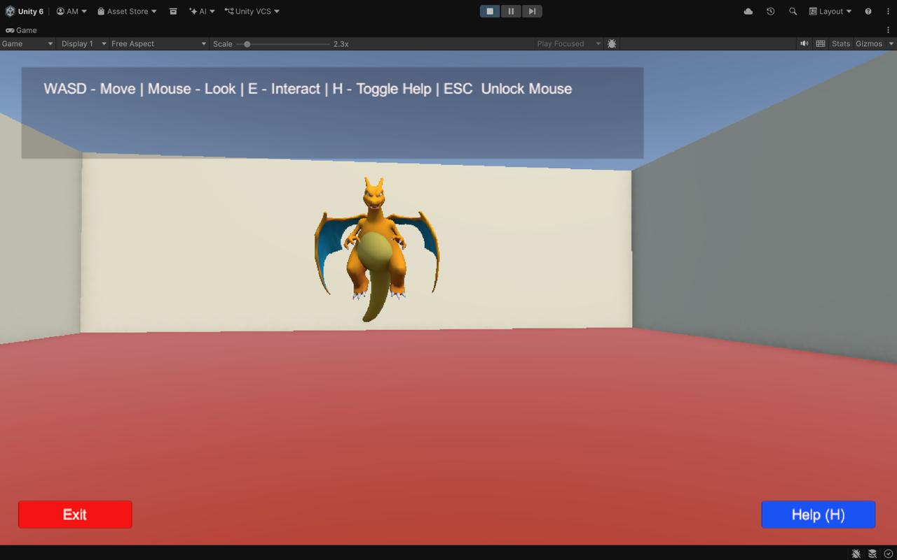

# Interactive 3D Environment — HCI ISE2

**Walchand College of Engineering, Sangli | Department of Computer Science and Engineering**  
**Course:** Human–Computer Interaction (HCI)  
**Assignment:** Design and Develop an Interactive 3D Environment Using Unity  
**Repository:** https://github.com/aditimittal38/Unity-3D

---

## What This Project Does

A desktop interactive 3D environment built in Unity demonstrating core HCI principles — visibility, feedback, consistency, affordance, user control, and error prevention.

The player navigates a 3D room using keyboard and mouse, and interacts with three objects:
- **Charizard Dragon** — press E to toggle flying animation
- **Light Switch** — press E to toggle a point light on/off (switch changes colour)
- **Door** — press E to smoothly open/close

---

## HCI Principles Demonstrated

| Principle | Where Applied |
|---|---|
| **Visibility** | Instructions panel always visible on screen; status messages appear on interaction |
| **Feedback** | Object colour changes, animation triggers, and status text on every interaction |
| **Consistency** | All interactions use the same key (E); all feedback appears in the same place |
| **Affordance** | Light switch turns yellow when on; door visually rotates open |
| **User Control** | WASD navigation, mouse look, H to toggle help, ESC to unlock cursor |
| **Error Prevention** | Interact range limited to 4 units; nothing triggers accidentally from a distance |

---

## Controls

| Key | Action |
|---|---|
| W A S D | Move |
| Mouse | Look around |
| E | Interact with object in crosshair |
| H | Toggle instructions panel |
| ESC | Unlock mouse cursor |
| Exit button | Quit game |

---

## Tech Stack

| | |
|---|---|
| Engine | Unity 6 (6000.5.10f1) |
| Render Pipeline | URP 17.5.0 |
| Platform | Desktop (Mac M1 / Windows) |
| Input | Unity Input Manager (Legacy) |
| 3D Model | Charizard (`charizard_006_legends_za`) |

---

## Scripts

| Script | Purpose |
|---|---|
| `PlayerController.cs` | WASD movement, mouse look, E-key raycast interaction |
| `InteractableObject.cs` | Handles Dragon / Light / Door interaction logic and feedback |
| `UIManager.cs` | Status text, instructions panel, exit and help buttons |

---

## Scene Setup

```
HCIScene
├── Directional Light
├── Player (CharacterController)
│   └── Main Camera
├── Plane (Floor)
├── Wall_Front / Wall_Back / Wall_Left / Wall_Right
├── CharizardPrefab        ← InteractableObject (Dragon)
├── Door                   ← InteractableObject (Door)
├── LightSwitch            ← InteractableObject (Light)
├── PointLight
└── Canvas (UIManager)
    ├── StatusText
    ├── InstructionsPanel
    ├── ExitButton
    └── HelpButton
```

---

## Screenshots

### 1. Creating the New Scene


### 2. Adding the Floor Plane


### 3. Add 3D Object — Plane Menu


### 4. Walls, Floor, and Player Added


### 5. Charizard Prefab in Project


### 6. Charizard Placed in Scene Hierarchy


### 7. Capsule Collider and Components Added


### 8. All Components Added — Full Inspector View


### 9. WASD Navigation Working in Play Mode


### 10. flyParam Animation Toggle — Charizard Flying


### 11. Scene Running on Mac M1 — Full Hierarchy View


### 12. Final Game View with UI Overlay


---

## How to Run

1. Clone: `git clone https://github.com/aditimittal38/Unity-3D.git`
2. Open in **Unity 6** (6000.5.10f1) — do not upgrade
3. Open **HCIScene** (`Assets/Scenes/HCIScene.unity`)
4. Go to **Edit → Project Settings → Player → Other Settings → Active Input Handling** → set to **Both**
5. Press **Play**

---

## Demo Video

[Watch the demonstration video](https://drive.google.com/file/d/1m8A6nE3qSddO3EzJZYPPxs085OBOg8Kc/view?usp=sharing)

---

## Project Structure

```
AR-Dragon-1/
├── Assets/
│   ├── Assets/charizard_006_legends_za/   ← 3D model + animations
│   ├── Materials/                          ← Floor, Wall, Door materials
│   ├── Scenes/
│   │   └── HCIScene.unity                 ← Main HCI interactive scene
│   └── Scripts/
│       ├── PlayerController.cs            ← Navigation + interaction input
│       ├── InteractableObject.cs          ← Object interaction logic
│       └── UIManager.cs                   ← HCI UI management
├── Screenshots/                           ← Implementation screenshots
└── Packages/manifest.json
```
